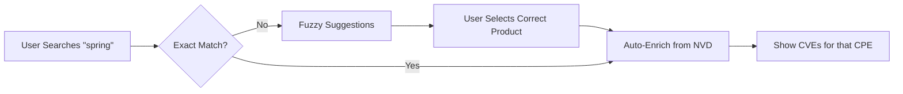

# VulnTrack - Enterprise Vulnerability Management System

<div align="center">      </div>

> From manual data entry to automated, enriched, and collaborative security management.

---

## The Problem

Traditional vulnerability management tools require security teams to manually:

- Look up CVE details from NVD
- Enter CVSS scores manually
- Match CPE names correctly (often leading to misidentification)
- Track vulnerabilities across dependencies
- Collaborate across teams without context
---

## Eliminating CPE Naming Chaos

### The CPE Problem

One of the biggest challenges in vulnerability management is **CPE (Common Platform Enumeration) naming**. Different vendors use different naming conventions:

|User Types|Actual CPE|
|---|---|
|`spring`|`cpe:2.3:a:vmware:spring_framework`|
|`spring-boot`|`cpe:2.3:a:vmware:spring_boot`|
|`log4j`|`cpe:2.3:a:apache:log4j`|
|`snakeyaml`|`cpe:2.3:a:snakeyaml_project:snakeyaml`|

### VulunTrack Solution

We integrated **[TII's CPEdict](https://github.com/tiiuae/cpedict)** - a curated CPE dictionary with over **64,000 mappings**. This solves the CPE naming ambiguity problem:

---
## 🏗️ Architecture Overview

```text

┌─────────────────────────────────────────────────────────────────┐
│                         Frontend (Next.js)                      │
│  ┌──────────────┐ ┌──────────────┐ ┌──────────────────────┐     │
│  │   CVSS v3.1  │ │   CVE/CWE    │ │  Dependency Scanner  │     │
│  │  Calculator  │ │   Lookup     │ │  (pom.xml, package)  │     │
│  └──────────────┘ └──────────────┘ └──────────────────────┘     │
└─────────────────────────────────────────────────────────────────┘
                              │
                              ▼
┌─────────────────────────────────────────────────────────────────┐
│                        Backend (Spring Boot)                    │
│  ┌─────────────┐ ┌─────────────────┐ ┌────────────────────┐     │ 
│  │   RBAC      │ │  Local NVD DB   │ │  CPE Mapping Engine│     │
│  │ (3 Roles)   │ │  (300k+ CVEs)   │ │  (64k+ CPEs)       │     │
│  └─────────────┘ └─────────────────┘ └────────────────────┘     │
└─────────────────────────────────────────────────────────────────┘
                              │
                              ▼
┌─────────────────────────────────────────────────────────────────┐
│                      PostgreSQL Database                        │
│  ┌────────────┐ ┌────────────┐ ┌──────────┐ ┌─────────────┐     │
│  │   Issues   │ │  Comments  │ │  Users   │ │  CVE Cache  │     │
│  │   (UUID)   │ │ (Activity) │ │  (RBAC)  │ │ (800k rows) │     │
│  └────────────┘ └────────────┘ └──────────┘ └─────────────┘     │
└─────────────────────────────────────────────────────────────────┘
```
---

## 📦 Local NVD Database

Instead of making **live API calls** to NVD (slow, rate-limited, unreliable):

- ✅ **800,000+ CVEs** pre-populated locally (saved with multiple vendors(A vendor could have multiple CVES))
    
- ✅ **Raw JSON Storage** - Store the complete NVD JSON for each CVE
    

---

## Features

### 1. **Smart CVE/CWE Lookup**

- Auto-populates CVE details when user types a CVE ID
- Fetches CVSS score, vector, description automatically
- Suggests CWE based on CVE data

### 2. **CVSS v3.1 Calculator**

- Interactive calculator with real-time score updates
- Live vector string generation
- Auto-populates severity based on CVSS score

### 3. **Dependency Scanner**

- Upload `pom.xml` (Maven), `package.json` (NPM), `requirements.txt` (Python)
- Auto-detects vulnerable dependencies
- Creates issues for each CVE automatically
- Supports both public (no auth) and authenticated scans

### 4. **Role-Based Access Control (RBAC)**

| Role                    | Permissions                                                   |
| ----------------------- | ------------------------------------------------------------- |
| **ROLE_ADMIN**          | Full access: manage users, delete any issue, view all reports |
| **ROLE_SECURITY_ADMIN** | Create/edit issues, CVE lookups, view global metrics          |
| **ROLE_DEVELOPER**      | View only assigned issues, update status (OPEN → RESOLVED)    |

### 5. **Collaboration & Live Chat**
 - Each issue page has an integrating live chat, that also works as activity tracking all over the issue lifecycle.

- Real-time comments via WebSocket
- Activity feed showing all status changes
- Auto-logs: "Researcher changed status to IN_PROGRESS"

### 6. **Professional Reports**

- Role-based PDF reports (admins see global, developers see assigned)
- Severity breakdown charts
- CWE distribution
- CVSS average scores

### 7. **Public Scanner**

- **Free public tool** for anyone to check dependencies
- No registration required
- CPE lookup tool with suggestions
- View CVEs for any CPE

---
## 🔗 API Endpoints

### Reach `http://localhost:8080/swagger-ui/index.html`

## Run
- A Backend dev profile integrated in repo, just export env in linux or windows and run it with:

```shell
$env:SPRING_PROFILES_ACTIVE="dev"; ./mvnw spring-boot:run
```

- Frontend
```shell
bun run dev
```

## Login

```
Admin creds -> admin : password
Dev1 creds  -> dev1 : password
Dev2 creds  -> dev2 : password
```

## PG database
- You can find PG database backup in root, add it to your current databases, name it with vuluntrack_dev, so spring boot can connect to it.

```
psql -U username -d database_name -f path/to/file.sql
```
